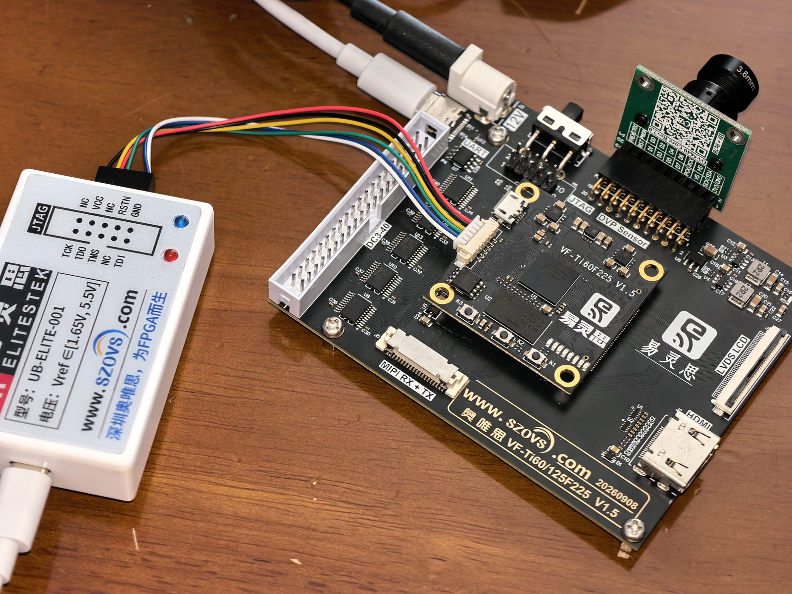
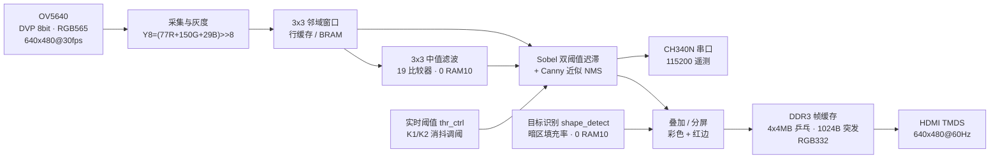

# 灵眸 · 实时图像边缘检测系统

> **2026 全国大学生嵌入式芯片与系统设计竞赛 · FPGA 创新设计赛道 · 易灵思赛题四**
> 队伍编号 **41259** ｜ 平台 **奥唯思 VF-Ti60F225**（Efinix Titanium Ti60F225）｜ 全 Verilog RTL 实现

基于 DDR3 帧缓存的 640×480 实时图像边缘检测系统：OV5640 采集 → FPGA 硬件流水线（灰度、Sobel/Canny、中值滤波、实时阈值、目标识别）→ DDR3 乒乓帧缓存 → HDMI 640×480@60 Hz 无撕裂显示，串口输出帧率与时序遥测。



---

## 1. 成果速览

| 指标 | 实测值 |
|---|---|
| 图像采集 | 640×480，**30.00 fps**（OV5640 VTS=1688），DVP 8 bit RGB565 |
| 图像显示 | HDMI **640×480 @ 60.00 Hz**，严格 2:1（hold=2），无撕裂无抽动 |
| 帧缓存 | 板载 DDR3，4 块 × 4 MB 乒乓缓冲，1024 B 顺序突发读写，RGB332 存储 |
| 边缘检测 | Sobel `Gx+Gy` + 双阈值迟滞；Canny（1-2-1 高斯 → 方向量化 → 3×3 近似 NMS → 双阈值滞后连接），输出 1 像素细边 |
| 降噪 | 3×3 中值滤波，19 个比较器纯组合实现，**0 块 RAM10** |
| 实时阈值 | K1/K2 按键消抖（2^20 周期）+ 步进 + 连发 + 钳位，同时作用于 Sobel 与 Canny |
| 目标识别 | 暗区填充率判据区分圆/矩形，**0 块 RAM10**、无需训练 |
| 时序 | **0 违例**，最小裕量 **+0.026 ns** |
| 逻辑资源 | RAM10 约 **83–103 / 256**（随 bitstream 形态），中值/阈值/识别模块均不占 RAM10 |

---

## 2. 系统架构



- **数据通路**：像素时钟 `clk_pixel` 下全硬件流水，采集→灰度→邻域→边缘→缓存→显示，延迟仅数行，无 CPU 参与。
- **无撕裂关键**：写侧按 1024 B 突发顺序写入当前 buffer，EOF 取摄像头 `frame_end`；读侧在帧起始通过 `done_toggle/done_bank` 握手切换 bank，保证一屏像素来自同一缓冲。
- **控制通路**：I2C 配置 OV5640、K1/K2 调整阈值、K3 全局复位、UART 输出状态字/帧周期/行周期/显示周期/hold。

---

## 3. 仓库结构

```
.
├─ 00_公共RTL/                公共 RTL：canny_core / median3x3 / thr_ctrl / shape_detect
│  └─ ddr/                    line_buffer / frame_buffer / dvp_capture / i2c_ov5640 / tmds_channel
├─ 01_源码_全分辨率彩色红边/    全分辨率工程（6 件套 + canny_core + ddr_frame_buffer + ov5640_cfg_rom）
├─ 02_源码_320左右分屏/        320 分屏工程（含中值 / Canny / 阈值 / 识别 + 2 个自检 testbench）
├─ 03_bit/                   已构建 bitstream —— 不随仓库分发，见 Releases
├─ 04_文档/                   技术报告（docx/pdf）、海报、视频介绍 PPT、交接与板测记录
├─ 05_构建/                   _build_rtl.ps1：map → PT → PnR → pgm 四步构建脚本
├─ 06_工具/                   串口抓取/判读、上板测试辅助脚本
├─ 07_官方IP/                 厂商 IP（DdrCtrl / W0_FIFO_8 / R0_FIFO_8），原样引用未修改
├─ 08_视频/                   演示视频（Release 下载）+ 分镜文案与录制清单
├─ 09_测试图/                 A4 可打印测试图（棋盘格 / 圆 / 方 / 人脸轮廓）
└─ docs/images/               实机照片（README 配图）
```

每个源码目录内的「6 件套」：`camera_hdmi.v`（顶层）、`ddr_frame_buffer.v`、`ov5640_cfg_rom.v`（传感器配置）、`camera_hdmi.sdc`（时序约束）、`camera_hdmi.peri.xml` / `.isf`（接口与引脚）、`camera_hdmi.xml`（工程文件）。

---

## 4. 快速开始

### 4.1 只想看效果

1. 到 **Releases** 页面下载 `bitstreams.zip`（7 套已构建 bit）与演示视频；
2. 按 §4.3 接线烧录，**无需重新综合即可运行**（烧写仍需 Efinity Programmer）。

### 4.2 仿真验证（Icarus Verilog，无需硬件）

```bash
cd "02_源码_320左右分屏"
iverilog -g2005 -o tb_thr.vvp  tb_thr_ctrl.v  thr_ctrl.v       && vvp tb_thr.vvp   # 阈值：抖动/连发/钳位
iverilog -g2005 -o tb_sd.vvp   tb_shape_detect.v shape_detect.v && vvp tb_sd.vvp    # 识别：圆/矩形/空帧
```

两个 testbench 自带 `TB PASS` 自检，可直接接入 CI。

### 4.3 综合与烧录

```text
1) 安装 Efinity 2026.1（厂商 HDK 与 IP 见 §8）
2) 把某个源码目录的「6 件套」放进 Efinity 工程目录
3) 按 05_构建/_build_rtl.ps1 的四步流程构建：
   efx_map → efx_run_pt_unified.py --peri_file → efx_pnr → efx_pgm
   产物：<工程目录>/outflow/camera_hdmi.bit
```

> ⚠️ `05_构建/_build_rtl.ps1` 中的 `EFINITY_HOME` 与工程目录是原作者机器上的绝对路径，构建前请改成自己的路径。
> ⚠️ IP 版本保持 `2022.2.322`，**不要升级官方 IP**；`ddr/axi4_ctrl.v` 使用官方原样版本。

**烧录注意事项**

- OV5640 排线需**反插**，否则不出图；
- 下载器 FTDI FT232H 需装 libusb-win32 驱动，设备管理器应显示为 `libusb-win32 devices / Single RS232-HS`（不是 COMx）；
- 烧录后等待 **≥5 秒**（扫灯 + DDR 校准自动完成），**不要按 K3**；
- 串口 115200-8-N-1：状态字 `FF`、相机帧周期 `0030D5C0`（30.00 fps）、显示周期 `0186A00`（60 Hz）、hold=`02` 即为正常。

---

## 5. 关键设计

| 设计点 | 做法与收益 |
|---|---|
| **DDR3 帧缓存无撕裂** | 4 块 × 4 MB 乒乓、1024 B 顺序突发、EOF 用摄像头帧边界而非地址回绕；读侧帧起始切 bank，消除整幅图逐帧左右抽动 |
| **Canny 硬件化** | 3×3 高斯 + Sobel + 方向量化（0/45/90/135）+ **3×3 幅值近似 NMS** + 双阈值滞后连接，避开 atan/CORDIC 与大量寄存器，输出 1 像素细边 |
| **中值降噪零 RAM** | `median3x3.v` 用 19 个比较器排序取中值，纯组合、0 块 RAM10，复用 Sobel 抽头对中心像素去噪 |
| **实时阈值** | `thr_ctrl.v` 对 K1/K2 两级同步 + 2^20 周期消抖 + 步进 8 + 连发 + 钳位 8~232，`hi = lo + 16`，同时驱动 Sobel 迟滞与 Canny 双阈值；上电直接输出初值 48/64，规避阈值 0 导致的初始红边爆炸 |
| **轻量目标识别** | `shape_detect.v` 统计中心 240×180 ROI 内暗像素（灰度 < 80）的 bbox 与数量，以**暗区填充率**判别：矩形 ≈0.9~1.0 → 实心块，圆 ≈π/4≈0.785 → 空心块；长宽比约束 0.7~1.43，无需训练与大规模存储 |
| **显示形态可切换** | 全分辨率彩色+红边叠加、全分辨率左右分屏（1:1 无马赛克）、320 分屏+中值，由不同 bitstream 现场切换 |

---

## 6. bitstream 一览（不随仓库分发，见 Releases）

| 编号 | 文件 | 覆盖能力 | 状态 |
|---|---|---|---|
| **A 高阶主推** | `camera_hdmi_fullres_enhanced_v6.bit` | 全分辨率彩色 + Canny 细红边 + K1/K2 实时阈值 + 圆/方识别 | ✅ 已上板 |
| **B 基础分屏** | `camera_hdmi_splitview_fullres.bit` | 全分辨率左右分屏：左 Canny 细边缘 / 右灰度，1:1 无马赛克 | ✅ 已上板 |
| **C 中值** | `camera_hdmi_split_lr_median.bit` | 3×3 中值 + 320 分屏，画面噪点明显减少 | ✅ 已上板 |
| D | `camera_hdmi_canny_strict_320.bit` | 320 分屏 Canny 严格版 | ✅ 已上板 |
| E | `camera_hdmi_fullres_color_edge.bit` | 彩色 + 红边基线（无阈值/识别） | ✅ 已上板 |
| F | `camera_hdmi_enhanced_320.bit` | 320 分屏形态增强版 | ⚠️ 备选 |

> 二进制产物统一放在 **Releases**，保持代码仓库轻量，`git clone` 无需下载数百 MB 历史。

---

## 7. 文档索引

| 文档 | 说明 |
|---|---|
| [技术报告 PDF](04_文档/技术报告_20261104_修订.pdf) ／ [DOCX](04_文档/技术报告_20261104_修订.docx) | 按官方模板撰写，含系统框图、模块说明、实测数据、参考文献 |
| [海报](04_文档/海报.pdf) ／ [视频介绍 PPT](04_文档/视频介绍PPT.pdf) | 作品展示海报与视频讲稿 |
| [提交清单](04_文档/提交清单.md) | 提交物逐项核对与关键指标 |
| [赛题要求对照](04_文档/_赛题要求对照_20261021.md) | 基础五项 / 高阶六项完成情况对照 |
| [交接文档（DDR3 帧缓存）](04_文档/交接文档_DDR3帧缓存工作线_2026-10-18.md) | 帧缓存工作线完整技术交接 |
| [板测记录](04_文档/_板测记录_20261029.md) | 上板实测记录 |
| [A4 测试图](09_测试图/测试图_A4_可打印.pdf) | 棋盘格 / Ø100 圆 / 100 方 / 轮廓+文字 / 人脸轮廓 |

---

## 8. 复现所需的外部资料

本仓库**不包含**以下第三方大体积资料，请自行获取：

- **奥唯思 VF-Ti60F225 硬件开发包（HDK V2.1）**——原理图、官方参考工程 `02-1_Ti60_OV5640_LCD-HDMI_1080P60`、下载器驱动；
- **Efinity 2026.1** 开发工具与器件数据库；
- OV5640 / K4B4G1646E 数据手册；
- 主办方赛题指南（请到 [官网](http://www.fpgachina.cn/) 获取，仓库内不转载）。

`07_官方IP/` 中的 DdrCtrl、FIFO 等 IP 为厂商提供、原样引用，版权归 Efinix / 奥唯思所有。

---

## 9. 已知限制

1. **P1 亮度回摆**：AEC 仍开启，缩略图均值有 ±5 缓慢回摆；手动曝光/增益寄存器映射未确认，不影响功能与帧率。
2. **320 分屏版为 2× 放大**：左半灰度分辨率低于全分辨率版本；全分辨率左右分屏因厂商 DDR IP 内部 `core_clk→twd_clk` 路径出现 -0.015 ns 违例，为守住「0 违例」指标未作为主推。
3. **时域 IIR 已关闭**：全分辨率下 `u_hist` 需约 300 块 RAM10，资源不足，降噪改由 3×3 中值滤波承担。

---

## 10. 说明

- 本项目为 **2026 全国大学生嵌入式芯片与系统设计竞赛**参赛作品，队伍编号 **41259**，作品名「灵眸」。
- 仓库当前为**私有**，赛事流程结束后再考虑公开；公开前请取得全体队员同意，并确认《参赛作品承诺及使用授权书》相关条款。
- 开发过程中使用了 AI 编程助手（DeepSeek Harness）辅助，AI 辅助工作量占比约 **35%**，涵盖代码修改、问题定位与材料整理；所有 AI 生成内容均经人工复核并上板验证，详见技术报告。
